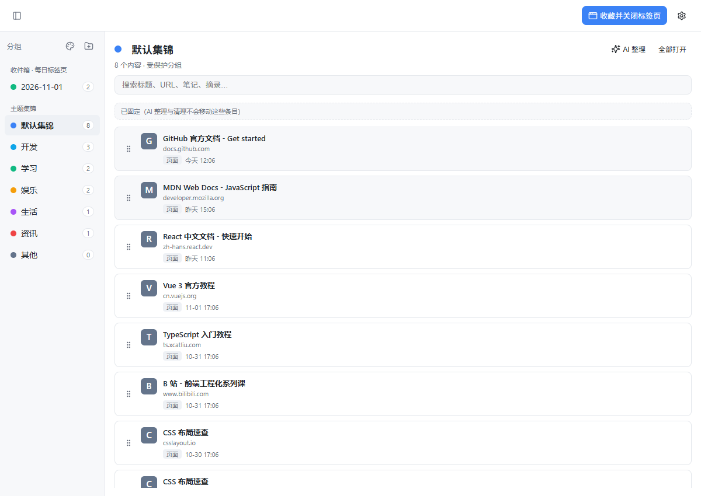
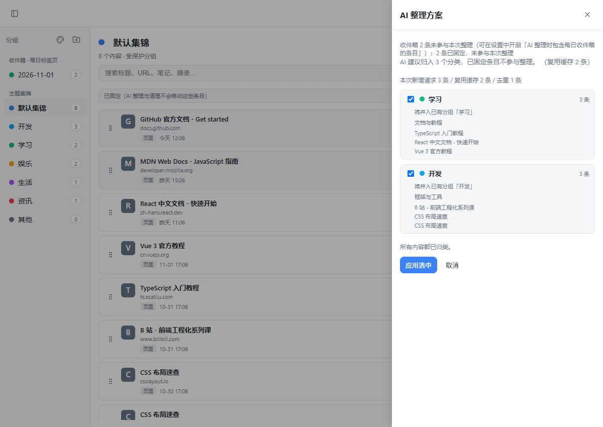
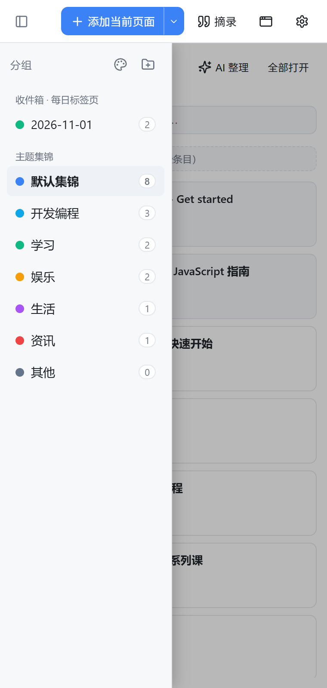
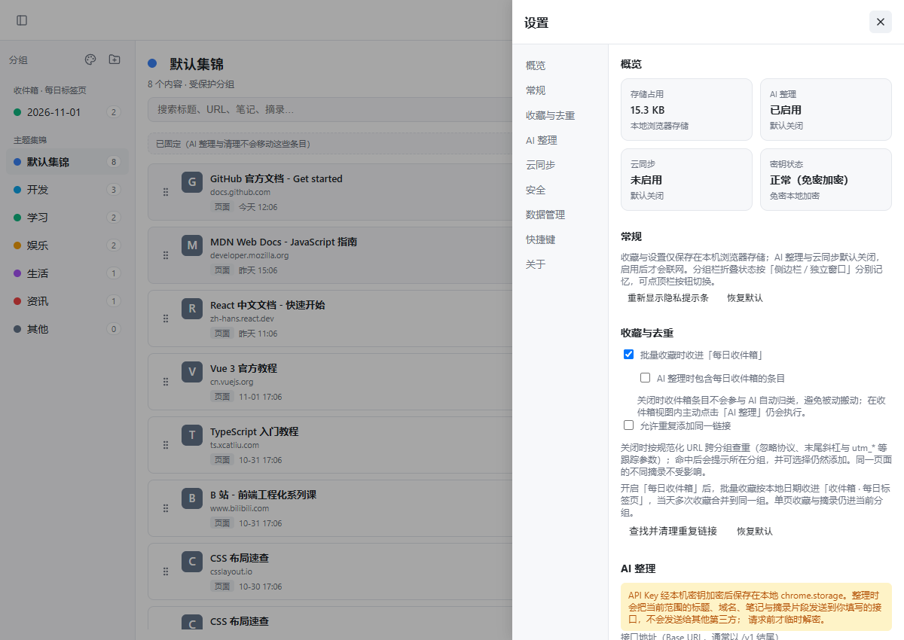
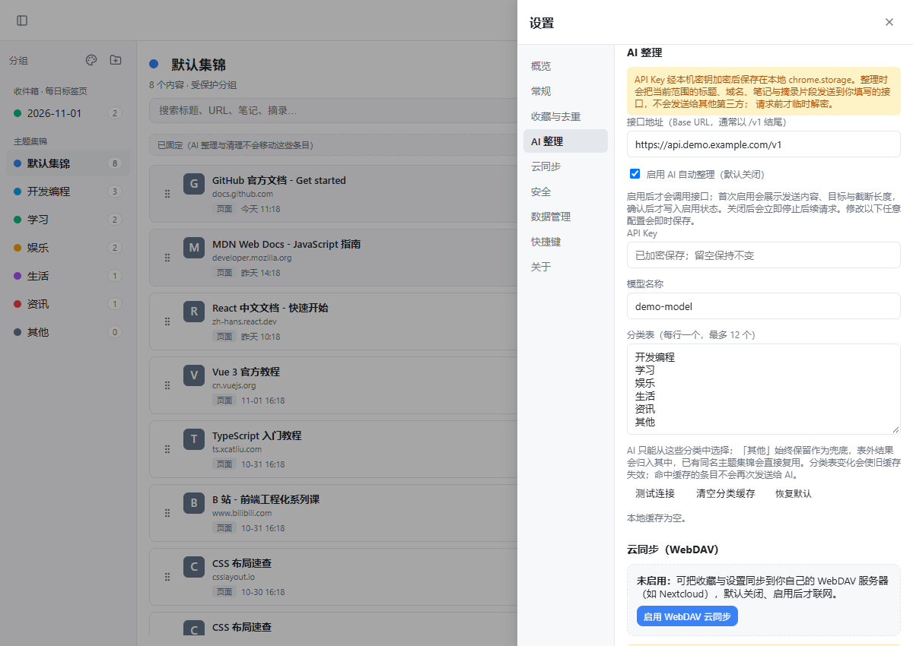
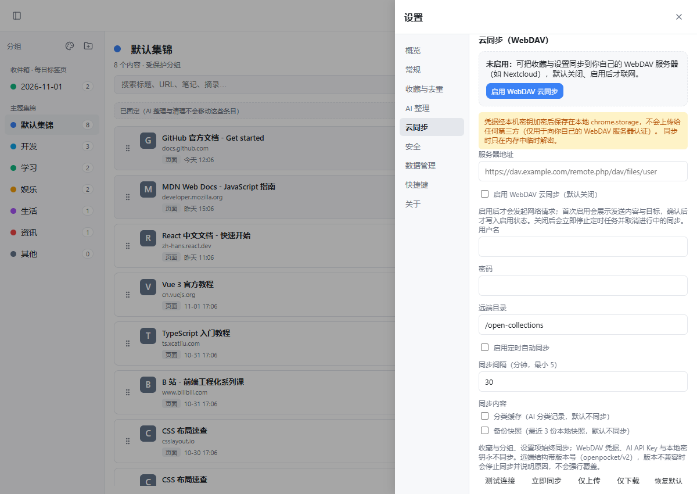
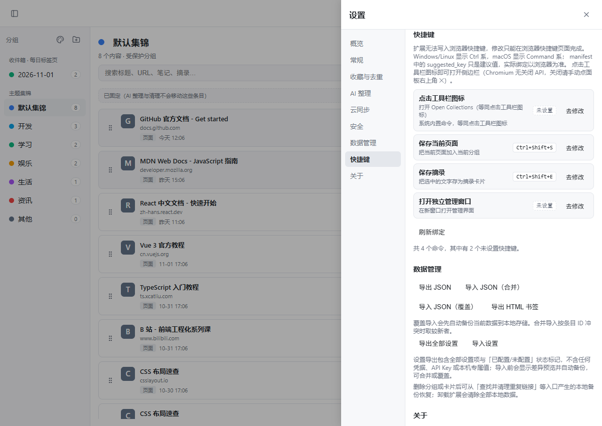

# Open Collections

本地优先的网页收藏与整理扩展（Chromium MV3，Edge / Chrome 114+）。替代 Edge 已移除的「集锦」，并融合 OneTab 式批量收藏：收藏当前页、批量收进标签页、保存网页选区为摘录，再用可选的 AI 按固定粗分类自动归组。数据默认只存在本机，可选 WebDAV 同步到**你自己的**服务器。无账号、无遥测、无远程代码、GPLv3 开源。

[](https://microsoftedge.microsoft.com/addons/detail/open-collections/dcdedbkplgmmgdogcfocoojihnhbaold)




> 所有截图均为演示数据渲染（详见 [docs/assets/screenshots/NOTE.md](docs/assets/screenshots/NOTE.md)）。

## 核心功能

- **收藏与摘录**：一键收藏当前页面（默认快捷键 `Ctrl+Shift+S`），保存选中文字为摘录卡片（默认 `Ctrl+Shift+E`，带来源链接）；点击工具栏图标在侧边栏打开，也可用命令打开独立管理窗口。
- **批量收藏**：把当前窗口全部网页标签收进分组或「收件箱 · 每日标签页」，可顺带关闭标签并保留一个新标签页；固定标签与浏览器内部页自动跳过。
- **AI 粗分类**（可选，默认关闭）：只从你维护的分类表（默认六项：开发 / 学习 / 娱乐 / 生活 / 资讯 / 其他）中选择，表外结果归入「其他」；整理前预览方案、显示本次新增请求与缓存复用数量，应用前自动备份、结果可撤销。只发送标题、域名、笔记与摘录片段（80/60/100 字截断），端点仅接受 https。
- **默认集锦与固定区**：「默认集锦」是受保护的系统分组，不可删除（允许重命名）。分组内每条卡片有图钉按钮——固定后的条目在顶部「已固定」区置顶，**对 AI 整理与重复清理免疫**，预览显示「N 条已固定，未参与本次整理」；取消固定即恢复参与。固定状态随条目持久化并参与同步。
- **同链接去重**（默认开启）：按规范化 URL 跨分组查重（忽略协议、末尾斜杠、`#` 与 `utm_*`、`gclid` 等跟踪参数）；命中直接跳过并提示所在分组（批量时汇总条数），需允许重复时在设置中关闭开关。另提供「查找并清理重复链接」：按组勾选、保留最早/最新、删除前备份、可撤销。
- **可选 WebDAV 同步**：默认同步「收藏与分组 + 设置项」；分类缓存与备份快照可选（默认关）。远端结构带版本号（`openpocket/v2` 多文件），条目级 `lastModified` 合并 + 删除墓碑，设置按键级时间戳取新；拉取前自动快照并报告新增/更新/删除计数；提供仅上传/仅下载；版本不兼容时停止并说明，不强行覆盖。**凭据与本地密钥永不同步**。
- **免密本地加密**：WebDAV 用户名/密码与 AI API Key 用本机自动生成的 256 位保险库密钥（AES-GCM）加密保存，密钥经本机设备密钥封装后存储，启动自动解封，**全程无需设置或输入任何密码**。旧版主密码数据提供一次性迁移（可跳过，旧密文保留不清空）。保留「清除本地密钥」（二次确认，不可恢复）。
- **设置导出 / 导入**：一键导出全部设置为 JSON（敏感项只记「已配置/未配置」，不含任何凭据值）；导入前 schema 校验 → 逐键差异预览 → 合并或覆盖 → 自动备份可回滚。收藏的 JSON/HTML 备份与导入另算一套。
- **设置页**：左侧分区导航（概览 / 常规 / 收藏与去重 / AI 整理 / 云同步 / 安全 / 数据管理 / 快捷键 / 关于）；概览提供存储、AI、同步、密钥四张状态卡片；控件即时生效，危险操作二次确认，未配置功能显示引导卡，各分区可恢复默认。
- **快捷键**：`Ctrl+Shift+S` 收藏当前页、`Ctrl+Shift+E` 保存摘录（均为建议键位，可在浏览器快捷键页修改）；设置页实时读取 `chrome.commands.getAll()` 显示当前绑定与冲突提示。**打开侧边栏只有点击工具栏图标这一个入口**（Chromium 无关闭 API，关闭请手动点面板 ✕）；另有未绑定键位的「打开独立管理窗口」命令。

## 安装

### Edge 加载项商店（推荐）

打开 [Edge 加载项商店 · Open Collections](https://microsoftedge.microsoft.com/addons/detail/open-collections/dcdedbkplgmmgdogcfocoojihnhbaold)，点击「获取」即可安装。商店版本与仓库一致。

### 离线 / 本地安装（备用）

适用于离线环境、开发者或 Chrome 用户。

1. 从 [Releases](https://github.com/SiRan-Dev/Open-Collections/releases/latest) 下载发布包 zip（如 `open-collections-1.2.0.zip`）
2. 打开 `chrome://extensions`（Edge 为 `edge://extensions`），开启「开发者模式」
3. 把 zip 文件直接拖入页面即可安装
4. 点击工具栏的 Open Collections 图标即可开始使用

若浏览器不接受拖入，解压 zip 后点击「加载已解压的扩展程序」，选择解压出来的文件夹。

直接改源码时，也可以克隆仓库（`git clone https://github.com/SiRan-Dev/Open-Collections.git`），在扩展页面点「加载已解压的扩展程序」选择仓库根目录（含 `manifest.json`）。

## 使用说明

- **侧边栏 vs 独立窗口**：点击工具栏图标打开侧边栏（窄视图，分组栏默认收起）；侧边栏右上角可打开独立管理窗口（默认 1200×850，按屏幕 92% 收敛并记住手动调整，最小宽度 960px）。独立窗口是扩展页面，顶部只保留一个主按钮「收藏并关闭标签页」（作用于最近活跃的普通浏览器窗口，多窗口时先弹选择器；先写入收藏再关闭标签，写入失败不关闭任何标签）。



- **收件箱与主题集锦**：开启「批量收藏时收进每日收件箱」后，批量收藏按日期进入「收件箱 · 每日标签页」暂存区；收件箱默认不参与 AI 归类，可在「设置 → 收藏与去重」勾选「AI 整理时包含每日收件箱的条目」，或在收件箱视图内主动点「AI 整理」（视为显式意图）。
- **跨分组拖拽**：卡片可在分组内排序，拖到左侧分组行或当前分组标题上跨组移动；空白区域为无效落点并给出反馈。
- **默认集锦固定区**：固定条目置顶显示并带琥珀色图钉角标；固定项也可从浏览器直接拖入链接到该区域创建（支持多行多个 URL，遵守去重设置）。







## 隐私与威胁模型

- 无账号、无分析、无广告、无遥测、无远程代码；全部数据保存在 `chrome.storage.local`，卸载即清除。
- 只有三种情况会联网或申请页面权限：① 你点「摘录」时读取当前页选中文字；② 你**启用并确认** WebDAV 后向**你自己填写的** https 服务器收发数据；③ 你**启用并确认** AI 整理后向**你自己填写的** https 接口发送当前整理范围的标题（≤80 字）、域名、笔记（≤60 字）、摘录片段（≤100 字）与 API Key。首次启用两者都会展示发送内容与目标，确认才生效；关闭即停止后续请求与定时任务。
- **威胁模型（如实说明）**：本地免密加密能降低浏览器存储被离线读取（拷贝 profile、备份泄露）时的泄露风险——离线只能看到密文；它**不能**防御已能读取本机浏览器配置或内存的恶意程序/扩展（设备密钥与保险库记录在同一存储中），也不能替代全盘加密、系统账户隔离或专用低权限账户。不信任当前设备时请不要保存凭据。
- 完整政策见 [隐私政策](https://siran-dev.github.io/Open-Collections/privacy.html)。

## 数据存放

| Key | 内容 |
| --- | --- |
| `openpocket:v1` | 全部分组与卡片（含软删除墓碑、固定标记、受保护分组标记） |
| `openpocket:settings` | WebDAV 配置、收藏行为、AI 接口/分类表；凭据以 AES-GCM 密文保存，明文字段不落盘 |
| `openpocket:vault` | 免密保险库：随机 256 位保险库密钥经本机设备密钥封装后的记录 |
| `openpocket:settings-meta` | 参与同步的各设置键最后修改时间（键级合并用） |
| `openpocket:ai-cache` | AI 分类缓存（内容哈希 + 分类表版本 → 分类名），最多 2000 条 |
| `openpocket:backup:<ts>-<reason>` | 同步 / 覆盖导入 / AI 整理前的自动快照，最多保留 10 份 |

## 已知限制

- 侧边栏入口只有点击工具栏图标；Chromium 不提供侧边栏关闭 API，关闭请点面板 ✕。快捷键是建议键位，可能被系统或其他软件抢占，需到浏览器快捷键页指定。
- 独立窗口聚焦时快捷键不会作用于网页（当前活动标签是扩展页面），请先切回普通浏览器窗口再按；独立窗口的「收藏并关闭标签页」按钮不受此限制。
- 「清除本地密钥」会一并删除已加密的 WebDAV 密码与 AI API Key 且不可恢复（不会回退为明文）。
- 定时同步依赖浏览器运行，休眠后可能推迟；WebDAV 端点必须是 https，纯 http 自建服务需先配 TLS。
- AI 整理至少 2 条、一次最多 80 条；仅支持 OpenAI 兼容 `chat/completions` 协议；更换模型不会让缓存失效（可手动清空分类缓存）。
- 默认去重按规范化 URL 判定，站点若把内容差异放在被忽略的参数里可能被误判，可在设置中允许重复。
- 摘录正文上限为 200,000 字符，超出时保留前面的内容并提示「已保存前 N 字」，建议分多次摘录；仅支持 http/https 页面，从侧边栏读取选区依赖 `activeTab` 授权，刚切换标签后可能失败，可在普通网页窗口改用快捷键。
- 本机存储接近上限时会明确提示空间不足并建议清理，而不是静默保存失败；单条摘要过大或收藏量很大时可能触发，删除旧摘录或清理重复项后可继续保存。

## 常见问题

**Q：数据存在哪？换电脑怎么办？**
A：全部在本机 `chrome.storage.local`。迁移方式三选一：① 设置页导出 JSON 备份（收藏的备份，含设置导出）；② 配置 WebDAV 同步；③ 导出 HTML 书签导入浏览器收藏夹。凭据不参与任何导出与同步，需在新机器重新填写。

**Q：需要账号吗？**
A：不需要。没有注册、登录、云端账号体系。

**Q：AI 是必须的吗？**
A：不是。AI 整理默认关闭，扩展的核心功能（收藏、搜索、拖拽、去重、同步）完全不依赖 AI。启用 AI 需要你自己提供 OpenAI 兼容接口与 Key。

**Q：和 Edge 原「集锦」有什么不同？**
A：本地数据格式开放（JSON 可导出）、支持摘录带来源、批量收藏每日收件箱、同链接去重、可选 AI 粗分类与 WebDAV 自托管同步、默认集锦固定区、设置可导出导入，且开源可审查。

**Q：「默认集锦」为什么删不掉？**
A：它是受保护的系统分组（首次安装创建，旧数据自动标记创建最早的分组），保证始终有一个固定归宿；可以重命名，内容可自由增删，固定条目不受 AI 与清理影响。

**Q：旧版的「主密码」去哪了？**
A：已移除。现在凭据由本机自动生成的保险库密钥加密（免密），检测到旧版主密码数据时设置页会提示一次性迁移；跳过不会清空数据。

## 开发与测试

纯 HTML/CSS/JS，无构建步骤。目录结构：

```text
manifest.json        MV3 清单（命令、权限、侧边栏声明）
background.js        Service Worker：快捷键、独立窗口、消息路由、定时同步、最近活跃网页标签记录
management.html      侧边栏与独立窗口共用的管理界面
management.css       样式（暗色模式、窄屏与独立窗口适配）
js/utils.js          ID、时间、颜色、URL 规范化、转义等工具
js/secret.js         免密保险库（随机密钥 + 设备密钥封装，AES-GCM）与旧版主密码数据迁移工具
js/storage.js        数据层：CRUD、软删除、固定/保护、导入导出、备份、同步合并、设置导入导出
js/webdav.js         WebDAV 请求、v2 远端结构、范围开关、错误分类
js/ai.js             OpenAI 兼容接口、提示词、JSON 解析与错误分类
js/app.js            管理界面逻辑
docs/                GitHub Pages 站点（介绍页 + 隐私政策）
tools/screenshots/   离线截图脚本（不随发布包分发）
```

验证：全部 JS 通过 `node --check`；17 组 Node + jsdom 测试套件共约 790 项断言（分组/卡片 CRUD、拖拽、去重与清理、免密加密与迁移、WebDAV 合并与范围、设置导入导出、设置页结构、独立窗口行为、默认集锦固定与保护、隐私合规、manifest 与 DOM 引用一致性）全部通过；打包产物经真实 Edge 加载验证。

## 致谢

界面图标来自 [Lucide](https://lucide.dev)（ISC 许可证，免费商用），以 inline SVG sprite 内嵌，颜色跟随 `currentColor` 自动适配明暗主题。

## 许可证

Copyright (C) 2026 SiRan-Dev. 本程序为自由软件：你可以根据自由软件基金会发布的 GNU 通用公共许可证第 3 版（GPLv3）条款重新分发和/或修改它。详见 [LICENSE](LICENSE)。
