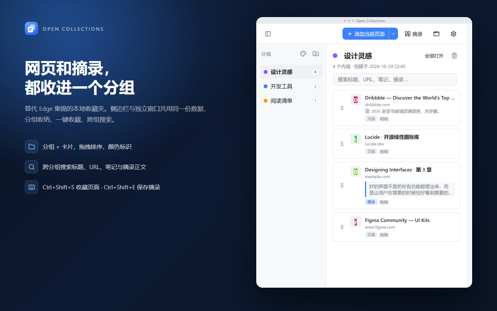
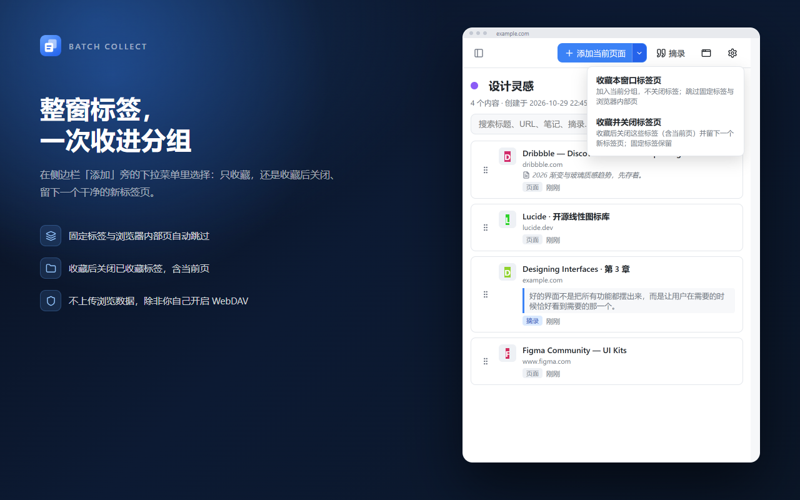
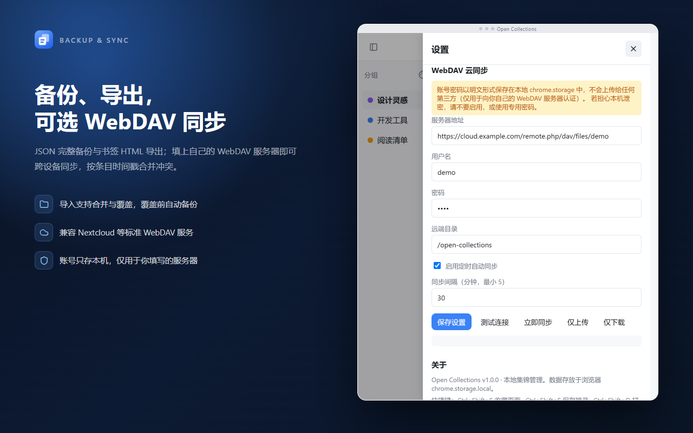

# Open Collections

**把网页和摘录收进分组，随时找回来。**

一个 Chromium Manifest V3 扩展，用来替代已下线的 Microsoft Edge「集锦（Collections）」。
纯 JavaScript / HTML / CSS，无构建、无依赖、无遥测，数据只存在你自己的浏览器里。




## 为什么做这个

Edge 砍掉「集锦」之后，浏览器自带的收藏夹又只适合按文件夹管理书签：没有分组颜色，没有笔记，摘录一段文字要开笔记软件。Open Collections 把这套动作收回浏览器里：

- 看到想留的页面 → `Ctrl+Shift+S` 直接进当前分组
- 看到想留的句子 → `Ctrl+Shift+E` 存成摘录，附带来源链接
- 开了一屏标签 → 「收藏并关闭」，收完留下一个干净窗口

## 功能

| 分类 | 能力 |
| --- | --- |
| **收藏** | 一键收藏当前页（标题 / URL / favicon / 时间）；批量收藏本窗口全部网页标签，可选「只收藏」或「收藏并关闭」；默认跨分组去重，可允许重复 |
| **每日标签页** | 可选 OneTab 模式：批量收藏按本地日期归入 `YYYY-MM-DD` 收件箱，当天多次收藏追加到同一组；收件箱是临时待整理区，主题集锦是已归类保存区 |
| **摘录** | 保存页面选中文字（最多 5000 字），记录来源标题与链接 |
| **分组** | 新建、重命名（失焦即保存）、删除、10 种颜色；侧栏显示每组条目数；每日标签页单独分区并按日期倒序 |
| **卡片** | 单击打开原链接；悬停可直接编辑（笔记 / 标题 / 链接）或删除；拖拽排序 |
| **搜索** | 跨全部分组匹配标题、URL、笔记、摘录正文，结果标注所属分组 |
| **AI 整理** | 可选自带 OpenAI 兼容接口：按固定分类表做粗分类，复用同名主题集锦，本地缓存去重省 token；预览确认后应用，支持撤销 |
| **批量打开** | 当前分组「全部打开」，每个链接一个新标签（超过 10 个会确认） |
| **双界面** | 侧边栏 + 480×720 独立窗口，共用同一份数据 |
| **数据** | JSON 完整备份（合并 / 覆盖导入）、Netscape HTML 书签导出 |
| **云同步** | 可选 WebDAV，支持定时自动同步与条目级冲突合并 |

<p>


</p>

## 安装

商店版本正在准备上架（Microsoft Edge 加载项），通过后会在这里补充链接。现在可以先本地加载：

1. 打开 `edge://extensions` 或 `chrome://extensions`
2. 打开「开发者模式」
3. 点「加载已解压的扩展程序」，选择本目录（包含 `manifest.json` 的文件夹）
4. 点工具栏里的 Open Collections 图标打开侧边栏；图标若被折叠，在扩展菜单里固定它

> 修改代码后在扩展管理页点「重新加载」即可生效；已打开的侧边栏需要关掉重开。

最低版本：基于 Side Panel API，需要 Edge / Chrome **114+**。

## 快速上手

1. 首次安装会自动创建「默认集锦」分组
2. 在任意网页按 `Ctrl+Shift+S`，页面进入当前分组
3. 选中一段文字后按 `Ctrl+Shift+E`，自动存成摘录卡片

### 快捷键

| 快捷键 | 作用 |
| --- | --- |
| `Ctrl+Shift+S` / `⌘Shift+S` | 把当前页面加入当前分组 |
| `Ctrl+Shift+E` / `⌘Shift+E` | 把当前选中文字存为摘录 |
| `Ctrl+Shift+O` / `⌘Shift+O` | 打开 / 关闭侧边栏 |

快捷键可能被其他软件占用，可在 `edge://extensions/shortcuts` 修改；若列表为空，说明组合键被系统或浏览器抢占了，需手动指定。

### 使用要点

- **收件箱与主题集锦**：开启 OneTab 模式后，批量收藏按日期进入「收件箱 · 每日标签页」，这是临时待整理区；「主题集锦」是已归类保存的长期分组。收件箱是临时暂存，**默认不参与 AI 自动归类**，避免被动搬动；需要一起整理时，在「设置 → 收藏行为」勾选「AI 整理时包含每日收件箱的条目」。在收件箱视图内主动点「AI 整理」视为显式意图，即使该开关关闭也会执行，并提示本次范围。
- **AI 整理**：在「设置 → AI 自动整理」填写接口地址、API Key 与模型名称，并维护分类表（默认：开发编程、学习、娱乐、生活、资讯、其他）。AI 只能从表中选分类，表外结果归入「其他」；同名主题集锦会复用。默认只整理当前主题集锦，收件箱条目会被跳过并在预览中标注「收件箱 N 条未参与本次整理」；勾选「AI 整理时包含每日收件箱的条目」后才会连同收件箱整理。预览会显示本次新增请求与缓存复用数量，应用前自动备份，结果页可撤销。
- **同链接去重**：默认开启，按规范化 URL 跨分组查重（忽略协议、末尾斜杠、`#` 片段与 `utm_*`、`gclid` 等跟踪参数）。命中时提示链接已存在于哪个分组，并可选「仍然添加」或跳过；批量收藏会列出重复项并只关闭真正收藏的标签页。设置中可勾选「允许重复添加同一链接」恢复想加就加的行为。同一页面的不同摘录按「来源 URL + 选区文本」判定，不受此开关影响。
- **清理重复链接**：设置页提供「查找并清理重复链接」；把「允许重复」由关变开并保存时，如果库中已有重复也会自动弹出。按组展示链接标题、所在分组与添加时间，默认折叠、可单组取消勾选；默认保留最早添加的一条，也可切换保留最新。执行前自动生成本地备份，完成后可在结果页撤销恢复；摘录不参与网页链接清理。
- **主密码与本地加密**：WebDAV 用户名/密码与 AI API Key 不再明文存储。先在「设置 → 主密码与本地加密」设置主密码（至少 8 位），凭据会用 PBKDF2-SHA256 派生密钥、AES-GCM 逐字段加密；磁盘只保存 salt、IV 与密文。解锁状态仅存于内存和浏览器会话存储，关闭浏览器即失效，可手动锁定并设置空闲自动锁定。旧版本残留的明文凭据会在首次设置主密码时自动加密并删除；未设置主密码时，保存凭据或调用 AI/WebDAV 会被引导先设置。
- **威胁模型**：主密码加密能降低浏览器存储被离线读取（如拷贝 profile、读取 `chrome.storage.local` 文件）时的泄露风险。**不能**防御已入侵本机、能读取扩展进程内存、注入页面或安装恶意扩展的攻击者；这些情况下运行中的明文仍可能被读取。它也不能替代全盘加密、系统账户隔离或专用低权限账户。若无法信任当前设备，请不要保存凭据。
- **摘录授权**：第一次在侧边栏点「摘录」时，浏览器会请求网页访问权限，允许后即可读取任意标签页的选区；拒绝后不影响其他功能，随时可在扩展详情里再开启，或改用快捷键。
- **批量收藏**：只处理 `http/https` 标签页，固定标签与内部页（`edge://`、`chrome://`、扩展页）自动跳过，也不会被关闭。
- **搜索**：搜索框为空时只显示当前分组；输入关键词后切换为跨分组搜索，此时拖拽排序暂时禁用。
- **favicon**：走扩展内置 `_favicon` 接口，不额外发起网络请求；取不到时显示标题首字母色块。

## 隐私

- 无账号、无分析、无广告、无遥测、无远程代码
- 全部数据保存在 `chrome.storage.local`，卸载扩展即清除
- 只有在以下三种情况才会访问网络或申请页面权限：
  1. 你点「摘录」时，读取当前页面选中的文字
  2. 你启用 WebDAV 时，向你**自己填写的**服务器收发数据
  3. 你使用 AI 整理时，向你**自己填写的** OpenAI 兼容接口发送当前整理范围的标题、URL、笔记与摘录片段（默认仅当前分组；开启收件箱参与后包含每日收件箱）

完整政策见 [隐私政策页面](https://siran-dev.github.io/Open-Collections/)。

## 数据存放

| Key | 内容 |
| --- | --- |
| `openpocket:v1` | 全部分组与卡片（含软删除墓碑） |
| `openpocket:settings` | WebDAV 配置、收藏行为设置与 AI 接口/分类表配置；凭据（WebDAV 用户名/密码、AI API Key）以 AES-GCM 密文保存，主密码派生密钥与解锁状态不落盘 |
| `openpocket:ai-cache` | AI 分类缓存（内容哈希 + 分类表版本 → 分类名），仅本地保存，最多 2000 条 |
| `openpocket:backup:<ts>-<reason>` | 同步 / 覆盖导入前的自动快照，最多保留 10 份 |

> 存储 key 沿用旧名 `openpocket:*`，是为了保留改名前的本地数据，与界面品牌无关，无需迁移。

建议先用「设置 → 导出 JSON」留一份备份，再折腾导入或同步。

## WebDAV 云同步

在「设置 → WebDAV 云同步」填写服务器地址、用户名、密码与远端目录（默认 `/open-collections`，不存在时自动 `MKCOL` 创建），可选定时自动同步（最小 5 分钟）。

<details>
<summary><b>操作语义与冲突策略</b></summary>

**操作**

- **测试连接**：`PROPFIND` 远端目录，404 时尝试创建
- **立即同步**：本地快照 → 下载远端 → 条目级合并 → 保存本地 → 回传远端
- **仅上传**：把本地存活条目的时间戳刷为当前，强制本地版本成为最新
- **仅下载**：用远端覆盖本地（覆盖前同样备份）；远端无文件时报错且不改动本地

**冲突**

按条目（分组、卡片）的 `updatedAt` 取新，不做整库覆盖；删除用墓碑标记 `deleted` + `deletedAt`：

- 远端编辑比本地新 → 用远端；比本地旧 → 保留本地
- 远端删除晚于本地最后编辑 → 删除本地；早于 → 保留本地内容
- 本地已删除但远端有更晚的未删除版本 → 复活该条目

**错误提示**：401 检查账号密码；403 检查目录权限；404 检查地址与远端目录；5xx 为服务器错误；网络不可达提示「网络错误」。

**远端文件**：目录本身 + `open-collections-data.json`。若之前用过旧版文件名 `openpocket-data.json`，需在服务器上重命名，否则不会被读取。

</details>

> **安全**：WebDAV 账号密码以**明文**保存在本机 `chrome.storage.local`。浏览器扩展无法提供真正的密钥保护，只有你填写的服务器会收到它。若担心本机被他人使用，建议不启用，或使用专用的低权限账号 / 应用专用密码。

## AI 自动整理（自带接口）

可选功能，默认不启用。在「设置 → AI 自动整理」填写：

- **接口地址**：OpenAI 兼容的 Base URL，例如 `https://api.deepseek.com/v1`；也可以填完整的 `/chat/completions` 地址
- **API Key**：用于 `Authorization: Bearer` 认证
- **模型名称**：例如 `deepseek-chat`、`gpt-4o-mini`
- **分类表**：每行一个，最多 12 个，默认六项：`开发编程`（截图、代码、电脑软件等）、`学习`、`娱乐`、`生活`、`资讯`、`其他`

**分类规则**：

- AI 只能从分类表中选择分类，不能自由生成名称
- 返回分类表以外的名称一律归入 `其他`；`其他` 始终保留作为兜底
- 同一领域的内容归入同一个粗分类，不按子主题、单篇内容或站点拆分
- 一次最多 3 个非 `其他` 分类；同一批里规范化同名的分类会合并
- 缓存命中可能补充此前已分类的粗分类分组，避免重复请求
- 已有主题集锦如果与分类名相同（忽略大小写、空格和常见分隔符），会直接复用，不会创建「 2」这类重名分组

**缓存与省 token**：

- 每条内容的缓存键由「内容/URL 稳定哈希 + 分类表版本」组成；内容或分类表变化才失效
- 已命中缓存的条目不再发送给模型；重复点击「AI 整理」不会重复计费
- 请求前按 URL 去重，同一 URL 只发送一条，分类结果再展开到重复项
- 标题截断到 80 字、笔记 60 字、摘录 100 字
- 预览会显示「本次新增请求 N 条 / 复用缓存 M 条 / 去重 D 条」；设置页可查看缓存记录数并一键清空

点「AI 整理」后，扩展只发送当前整理范围的标题、URL、笔记与摘录片段。界面先展示预览，只有你点击「应用选中」才会：

1. 自动备份当前数据
2. 复用同名主题集锦或创建新主题分组
3. 把卡片复制到目标分组，并在原分组留下删除墓碑（保证 WebDAV 同步不会复活旧卡片）

结果页提供「撤销本次整理」，恢复到应用前的快照。撤销只影响本地；如果整理后已经同步到 WebDAV，请再用「仅上传」覆盖远端。AI 不读取网页正文，至少需要 2 条、一次最多处理 80 条内容；目前仅支持 OpenAI 兼容的 `chat/completions` 协议，Azure OpenAI 的 `api-key` 头等变体需要自行使用兼容代理。

网络或模型报错时不会修改任何数据，界面会显示可读原因并保留未分类状态，可重试或关闭。

> **安全**：AI API Key 同样以**明文**保存在本机 `chrome.storage.local`，只会发送给你填写的接口。若担心本机被他人使用，请不要配置，或使用专用的低额度 Key。

## 已知限制

- 密码与 AI API Key 明文存储（见上）
- 定时同步依赖浏览器运行，休眠后可能推迟
- 侧边栏与独立窗口同时编辑按「最后一次写入」生效，没有版本号并发保护
- 覆盖导入会先备份，但界面暂未提供备份恢复入口（可从 `chrome.storage.local` 的备份键取回）
- AI 整理至少需要 2 条、一次最多 80 条内容；默认只整理当前主题集锦，开启「AI 整理时包含每日收件箱的条目」后才会连同收件箱一起整理；分类表最多 12 项
- AI 整理仅支持 OpenAI 兼容的 `chat/completions` 协议，不执行模型返回的任何代码或指令
- 默认去重按规范化 URL 判定（忽略协议、末尾斜杠与常见跟踪参数）；如果站点把内容差异放在被忽略的参数里，可能被误判为重复，可在设置中允许重复或手动添加
- 快捷键「添加当前页面」命中重复时只提示所在分组；需要强制添加时请在侧边栏/独立窗口点击「添加当前页面」并选择「仍然添加」
- 主密码遗忘后无法恢复已加密的 WebDAV 密码与 AI API Key；只能清除主密码并重新填写。清除主密码会一并删除已加密凭据，不会回退为明文
- 解锁状态保存在浏览器会话存储中；浏览器完全退出后自动同步需要重新解锁，锁定时定时同步会提示失败而不是静默跳过
- 主密码加密不能防御已入侵本机或恶意扩展读取运行中的内存；威胁模型详见上文「使用要点」
- AI 缓存只保存在本机，不随 WebDAV 同步；清空缓存后下次会重新请求
- 更换 AI 模型不会自动让缓存失效；需要重新分类时请清空分类缓存
- 旧版本已经创建的细粒度主题集锦不会自动合并；可将想要的粗分类加入分类表后由 AI 复用，或手动整理
- 搜索状态下不支持拖拽排序；排序只在当前分组内持久化
- 摘录正文截断到 5000 字符，仅支持 `http/https` 页面
- 从侧边栏读取选区依赖 `activeTab` 授权，刚切换标签后可能失败，可改用快捷键
- 导出的书签 HTML 中，摘录卡片以 `[摘录] 标题` 形式出现，正文放在书签描述里

## 目录结构

```text
manifest.json        MV3 清单
background.js        Service Worker：快捷键、独立窗口、消息路由、定时同步
management.html      侧边栏与独立窗口共用的管理界面
management.css       样式（暗色模式 + 窄屏适配）
js/utils.js          ID、时间、颜色、转义等工具
js/storage.js        数据层：CRUD、软删除、导入导出、备份、同步合并
js/webdav.js         WebDAV 请求与错误分类
js/ai.js             OpenAI 兼容接口、提示词、JSON 解析与错误分类
js/app.js            管理界面逻辑
icons/               16/32/48/128 图标（make-icons.js 用于重新生成）
store-assets/        商店列表截图（1280×800）
RELEASE.md           发版与 Edge 商店上架材料（文案、隐私政策、权限说明）
dist/                打包产物（git 忽略）
```

## 开发

无构建、无依赖。把目录作为解压扩展加载即可。

### 重新生成图标

```bash
node icons/make-icons.js
```

图标是脚本用 Node 内置 `zlib` 直接写 PNG（SDF 圆角 + 超采样抗锯齿），改 `make-icons.js` 顶部的几何与颜色常量即可调整。

### 打包发布

```bash
# 详见 RELEASE.md「后续发版流程」
```

打包会排除开发文件，只保留运行必需的内容（含 `LICENSE`），产物在 `dist/open-collections-<版本>.zip`。

### 已验证

- 全部 JS 通过 `node --check`；`manifest.json` 符合 MV3 且引用路径齐全
- 图标为有效 PNG（16 / 32 / 48 / 128）
- 界面代码引用的 DOM id 与 HTML 完全对应
- 内存版 `chrome.storage` 的 Node 测试：分组与卡片 CRUD、排序、软删除、JSON / HTML 导出、合并与覆盖导入、备份、5 种同步冲突、WebDAV 错误分类、三种同步模式，共 44 项断言通过
- jsdom 加载真实页面与脚本的界面冒烟测试：渲染、跨分组搜索、打开链接、编辑保存、添加页面、独立窗口入口、设置回填、空状态、损坏数据、删除卡片，共 34 项断言通过
- 每日标签页、精确时间、设置合并、固定粗分类、其他兜底、同名复用、缓存版本/去重/截断/请求统计的 Node 46 项与 jsdom UI 34 项断言通过
- jsdom 跨分组拖拽 25 项断言（落点判定、顺序保持、持久化、空状态、无效区域）与 AI 收件箱开关 39 项断言（默认跳过、开启参与、收件箱视图显式执行、旧数据默认值）通过
- 跨分组同链接去重 29 项断言（规范化 URL、默认命中、仍然添加、允许重复、摘录 URL+文本、AI 请求/写入去重）通过
- 重复链接清理 32 项 jsdom 断言（仅开启且存在重复时弹窗、保留最早/最新、取消勾选组保留、备份与撤销、无重复不弹窗）通过
- 主密码加密 42 项断言（加解密往返、错误密码拒绝、迁移删除明文、失败回滚、锁定拒绝、更换/清除、导出不含密钥、控制台无密钥）通过
- 真实 Edge 加载打包产物：Service Worker 无报错、首次安装自动建组、界面与版本号正常

## 致谢

界面图标来自 [Lucide](https://lucide.dev)（ISC 许可证，免费商用），以 inline SVG sprite 内嵌在 `management.html`，颜色跟随 `currentColor`，自动适配明暗主题。

## 许可证

Copyright (C) 2026 SiRan-Dev

本项目以 **GNU General Public License v3.0** 发布，全文见 [LICENSE](./LICENSE)。

你可以自由使用、修改和分发本项目；分发修改后的版本时，需同样以 GPLv3 开源并提供对应源码。
